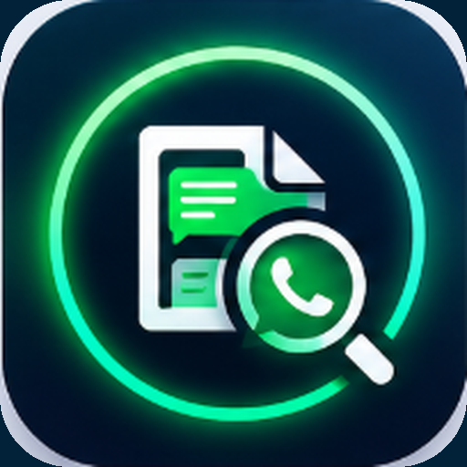
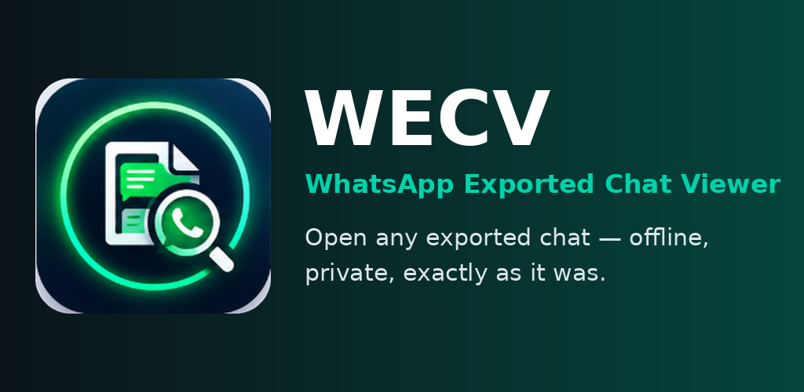
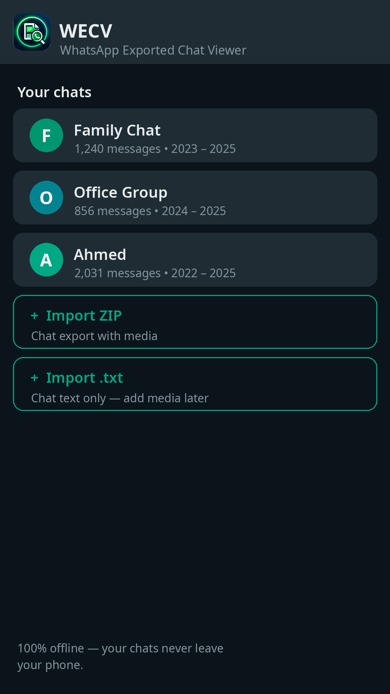
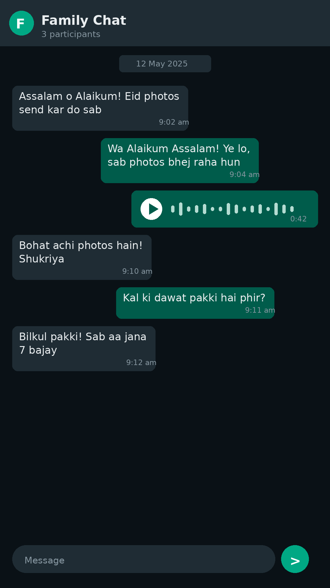
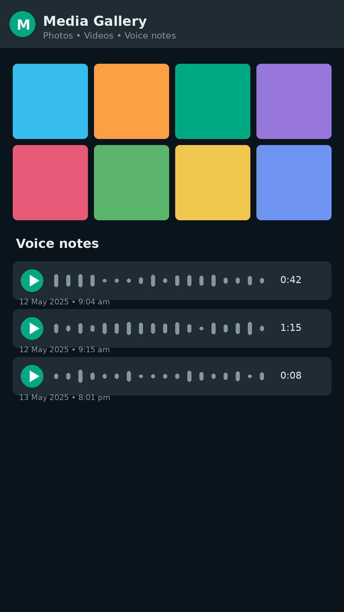

<p align="center">
  
</p>

<h1 align="center">WECV — WhatsApp Exported Chat Viewer</h1>

<p align="center">
  <strong>Open any exported WhatsApp chat on Android — offline, private, exactly as it was.</strong>
</p>

<p align="center">
  <a href="https://github.com/qasima1i/WECV-Whatsapp-Exported-Chat-Viewer/releases/latest"></a>
  
  
  
</p>

<p align="center">
  
</p>

Export a chat from WhatsApp, open it in WECV, and read it in a familiar chat
view — with every message on the correct side, its real date and time, and all
its media. **No WhatsApp account. No internet. No sign-up.**

## 📥 Download

**[⬇️ Get the latest APK from Releases](https://github.com/qasima1i/WECV-Whatsapp-Exported-Chat-Viewer/releases/latest)**

Install it on any Android phone (Android 7.0 or above), then open an exported
chat ZIP or `.txt` file. That's it.

## 📸 Screenshots

<p align="center">
  
  
  
</p>

## ✨ Features

- 📂 **Import a full export ZIP** (with media) or a plain **.txt** file — media can be added later
- 👥 Personal and **group chats** supported (in-bubble sender names)
- 🕒 Exact dates and times, in original order — nothing added, changed or removed
- 🎙️ **Voice notes** play inside the chat, with waveform and seek
- 🖼️ Photos and videos open full-screen — swipe between photos, save or share them
- 🎞️ **Animated stickers** play as animations
- 🗂️ Media gallery with **Media | Voice** tabs, plus *Go to message*
- ⭐ **Star** important messages and find them again in one tap
- 🔍 Search inside the chat, or jump to any date with the calendar
- 🌙 Dark and light themes, chat bubble colours
- 👆 Long-press any message to copy, delete or star it (deleted messages can be restored)

## 🚀 How to use

1. In WhatsApp, open a chat → **⋮ → More → Export chat** (choose *Include media* for photos and voice notes)
2. Install and open **WECV**
3. Tap **Import ZIP** (or **Import .txt**) and pick the export file
4. Pick **which sender is you** — so your messages land on your side
5. Read your chat, exactly as it was

## 🔒 Privacy

WECV works **100% offline**. The app has **no INTERNET permission**, collects
**no data**, shows **no ads** and has **no accounts**. Your chats are parsed
and stored only in the app's private storage on your own device — they never
leave your phone. See [PRIVACY.md](PRIVACY.md).

## 🛠️ Building from source

Plain Java + Android SDK command-line tools — no Gradle or Android Studio needed.

Requirements: JDK 17, Android SDK platform 36, build-tools 36 (`aapt2`, `d8`,
`zipalign`, `apksigner`).

```bash
export ANDROID_JAR=$ANDROID_SDK/platforms/android-36/android.jar
export BT=$ANDROID_SDK/build-tools/36.0.0

$BT/aapt2 compile --dir res -o build/res.zip
$BT/aapt2 link -o build/app-unsigned.apk -I $ANDROID_JAR \
    --manifest AndroidManifest.xml -R build/res.zip -A assets --auto-add-overlay

javac -encoding UTF-8 -cp $ANDROID_JAR -d build/classes $(find src -name '*.java')
# add classes.dex (via d8) to the APK, zipalign, then sign with your own keystore:
$BT/apksigner sign --ks your.keystore --out WECV.apk build/app-aligned.apk
```

> The signing keystore is **not** in this repository — create your own and never commit it.

## 📁 Project layout

| Path | What it is |
|---|---|
| `src/com/wecv/viewer/` | All Java sources — parser, chat UI, gallery, viewers |
| `res/` | Launcher icons |
| `assets/emoji/` | Emoji images used to render chat emoji consistently |
| `AndroidManifest.xml` | Package `com.wecv.viewer` · minSdk 24 · targetSdk 36 |

## 📜 License

Source code is released under the [MIT License](LICENSE).
Emoji images in `assets/emoji/` belong to their respective owners and are
included only so the app can render chat emoji; they are not covered by MIT.

---

<p align="center"><em>WECV is an independent viewer and is not affiliated with WhatsApp LLC or Meta Platforms, Inc.</em></p>
